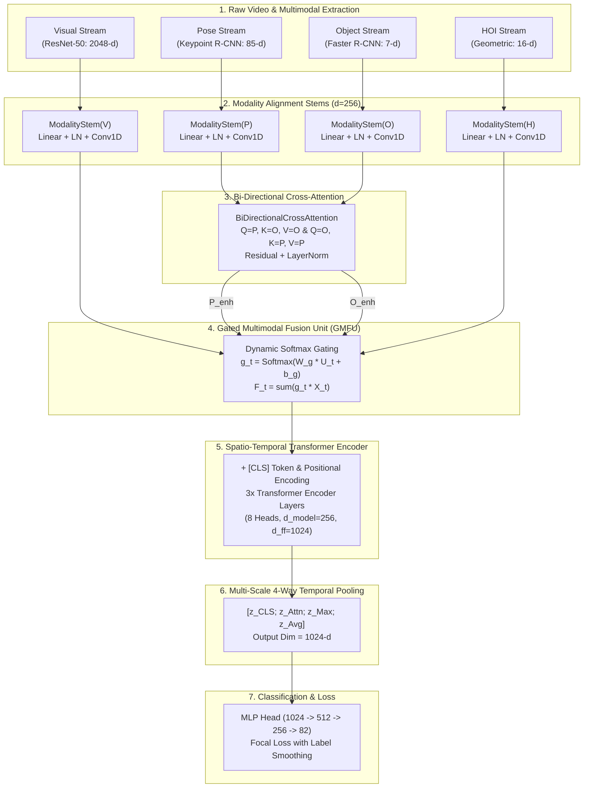

# CMAT-HOI: Complete Methodology Specification & Formal Mathematical Formulation

> **Document Purpose**: Self-contained, publication-ready technical specification of the proposed **CMAT-HOI** (*Cross-Modal Attention Transformer for Human–Object Interaction*) architecture.  
> **Target Sections**: Section 3 (Methodology) in IEEE Transactions / Conference Papers / Master's Thesis.  
> **Reference Architecture**: `src/models/hoi_transformer.py`  
> **Accompanying High-Res Diagram**: `figures/system_architecture_diagram.png`  
> **Skill Standard Followed**: `research-paper-writing` Module Triad (Motivation, Module Design, Technical Advantages).

---

## 1. Problem Formulation & System Overview

Let $\mathcal{V} = \{v_i, y_i\}_{i=1}^N$ denote a training dataset of $N$ sports video sequences, where each video $v_i$ is annotated with an action label $y_i \in \{1, 2, \dots, C\}$ across $C = 82$ fine-grained athletic categories. 

Each raw video $v_i$ is temporally discretized into a uniform sequence of $T = 16$ equidistant frames. From each frame $t \in \{1, 2, \dots, T\}$, four synchronized multimodal feature representations are extracted:
1. **Visual Stream ($X_V \in \mathbb{R}^{T \times 2048}$)**: Scene context and full-body appearance extracted from the global average pooling layer (`pool5`) of an ImageNet-pretrained ResNet-50.
2. **Kinematic Pose Stream ($X_P \in \mathbb{R}^{T \times 85}$)**: Articulated human skeletal kinematics extracted using Keypoint R-CNN. Comprises $17$ anatomical body joints: $(x_j, y_j, v_j)$ coordinates and detection confidences ($51$-d) concatenated with normalized inter-frame joint velocity vectors $(\Delta x_j, \Delta y_j)$ ($34$-d).
3. **Equipment Object Stream ($X_O \in \mathbb{R}^{T \times 7}$)**: Sports apparatus bounding box dynamics extracted using Faster R-CNN filtered across 15 COCO sports categories. Encodes normalized bounding coordinates, detection confidence, class index, and relative bounding area: $[x_1, y_1, x_2, y_2, s, c, a]$.
4. **Geometric HOI Stream ($X_H \in \mathbb{R}^{T \times 16}$)**: Explicit human–object interaction kinematics, computing pairwise Euclidean distances, relative angles, and rate of distance change between the athlete's primary effectors (left wrist, right wrist, left ankle, right ankle) and the equipment centroid.

---

## 2. Module 1: Dimension-Aligned Modality Stems (`ModalityStem`)

### 2.1 Motivation
In naive multimodal architectures, raw features are concatenated directly into a monolithic vector $[X_V; X_P; X_O; X_H] \in \mathbb{R}^{2156}$. However, the visual stream ($2048$-d) has an $L_2$ norm $\|X_V\|_2 \in [20, 50]$, whereas pose ($85$-d) has $\|X_P\|_2 \in [1, 3]$ and objects ($7$-d) have $\|X_O\|_2 \in [0.5, 1.5]$. This causes **multimodal representation collapse**: the visual backbone accounts for $>95\%$ of the dimensions and $>93\%$ of backpropagation gradients, forcing the network to behave as a static court/stadium background classifier while ignoring limb and equipment motion.

### 2.2 Detailed Mathematical Formulation
To eliminate dimension and gradient scale disparities, each stream $m \in \{V, P, O, H\}$ is mapped into a uniform representation space of dimension $d = 256$:

$$\tilde{X}_m = \text{LayerNorm}(W_m X_m + b_m), \quad W_m \in \mathbb{R}^{d \times D_m}, \quad b_m \in \mathbb{R}^d$$

To capture local frame-to-frame temporal correlations (e.g., instantaneous acceleration or micro-movements across consecutive frames), a 1D temporal convolution with residual connection and GELU activation is applied:

$$C_m = \text{Conv1D}_{k=3, p=1}(\tilde{X}_m^\top)^\top \in \mathbb{R}^{T \times d}$$

$$H_m = \text{Dropout}\left(\text{GELU}(\tilde{X}_m + C_m), \; p=0.2\right) \in \mathbb{R}^{T \times 256}$$

### 2.3 Technical Advantages
- **Equalized Gradient Flow**: All four modalities contribute equally to early gradient dynamics.
- **Local Temporal Receptive Field**: The $k=3$ temporal convolution provides local boundary smoothing across consecutive frames before global self-attention.
- **Modular Adaptability**: Supports dynamic ablation (e.g., dropping the visual stream during inference without architectural modification).

---

## 3. Module 2: Bi-Directional Cross-Modal Attention (`BiDirectionalCrossAttention`)

### 3.1 Motivation
Sports actions are defined by the physical interaction between the athlete's joints and athletic apparatus. For instance, distinguishing *TennisSwing* from *BadmintonSmash* or *GolfSwing* requires establishing spatiotemporal correspondence between hand-grip coordinates and racquet/club orientations. Independent feature encoding fails to model these pairwise dependencies.

### 3.2 Detailed Mathematical Formulation
Let $P \in \mathbb{R}^{T \times d}$ and $O \in \mathbb{R}^{T \times d}$ denote the aligned pose and object feature matrices ($d = 256$). We define mutual multi-head scaled dot-product cross-attention:

$$\text{MHA}(Q, K, V) = \left[ \text{head}_1; \; \text{head}_2; \; \dots; \; \text{head}_h \right] W^O$$

$$\text{head}_i = \text{Softmax}\left(\frac{Q W_i^Q (K W_i^K)^\top}{\sqrt{d_k}}\right) V W_i^V$$

where $h = 4$ attention heads, $d_k = d / h = 64$, and projection matrices $W_i^Q, W_i^K, W_i^V \in \mathbb{R}^{d \times d_k}, W^O \in \mathbb{R}^{d \times d}$.

1. **Pose-to-Object Cross-Attention**: Human keypoints query the sports apparatus:
   $$P_{\text{attn}} = \text{MHA}(Q=P, \; K=O, \; V=O)$$
   $$P_{\text{enh}} = \text{LayerNorm}(P + \text{Dropout}(P_{\text{attn}}, p=0.2)) \in \mathbb{R}^{T \times 256}$$

2. **Object-to-Pose Cross-Attention**: Sports apparatus queries the human keypoints:
   $$O_{\text{attn}} = \text{MHA}(Q=O, \; K=P, \; V=P)$$
   $$O_{\text{enh}} = \text{LayerNorm}(O + \text{Dropout}(O_{\text{attn}}, p=0.2)) \in \mathbb{R}^{T \times 256}$$

### 3.3 Technical Advantages
- **Contextual Joint Enhancement**: Joint coordinates are enriched by knowing whether they are in contact with or near sports gear.
- **Noise Filtering**: Equipment detections in crowded sports scenes that do not interact with the athlete receive low attention weights and are naturally suppressed.

---

## 4. Module 3: Gated Multimodal Fusion Unit (GMFU)

### 4.1 Motivation
In different athletic actions, the relative importance of visual scene context versus kinematic motion varies dynamically across time. In *GolfSwing*, visual court features remain static, but wrist angle is critical. Conversely, in *SkyDiving*, visual scene textures provide dominant signals. A static linear combination cannot handle frame-to-frame variations.

### 4.2 Detailed Mathematical Formulation
At each frame $t \in \{1, \dots, T\}$, the enhanced multimodal streams are concatenated into a joint temporal token:

$$U_t = [V_t; \; P_{\text{enh}, t}; \; O_{\text{enh}, t}; \; H_t] \in \mathbb{R}^{1024}$$

A two-layer gating MLP computes dynamic softmax gating weights across the $M=4$ active modalities:

$$s_t = W_2 \cdot \text{GELU}(W_1 U_t + b_1) + b_2 \in \mathbb{R}^4$$
$$g_t = \text{Softmax}(s_t) = \left[ g_t^{(1)}, \; g_t^{(2)}, \; g_t^{(3)}, \; g_t^{(4)} \right], \quad \sum_{m=1}^4 g_t^{(m)} = 1$$

where $W_1 \in \mathbb{R}^{256 \times 1024}, W_2 \in \mathbb{R}^{4 \times 256}$.

The dynamically fused frame representation $F_t \in \mathbb{R}^{256}$ is computed as:

$$F_t = \text{LayerNorm}\left( \sum_{m=1}^4 g_t^{(m)} X_t^{(m)} \right)$$

where $X_t^{(1)} = V_t, X_t^{(2)} = P_{\text{enh}, t}, X_t^{(3)} = O_{\text{enh}, t}, X_t^{(4)} = H_t$.

### 4.3 Technical Advantages
- **Adaptive Background Suppression**: When rapid physical movements occur, $g_t^{(1)} \to 0$, preventing visual background clutter from misleading the classifier.
- **Convex Combination Stability**: The softmax constraint guarantees numerical stability and prevents unbounded activation growth across layers.

---

## 5. Module 4: Spatio-Temporal Transformer Encoder

### 5.1 Motivation
Sports actions unfold over extended temporal trajectories with distinctive rhythmic cadences (e.g., preparation, explosive phase, follow-through). Standard recurrent networks (LSTMs/GRUs) suffer from vanishing gradients and sequential processing bottlenecks. Self-attention provides direct, unrestricted receptive fields across all frames.

### 5.2 Detailed Mathematical Formulation
1. **Classification Token & Positional Encoding**: A learnable parameter $z_{[\text{CLS}]} \in \mathbb{R}^{1 \times 256}$ is prepended to the fused temporal sequence:
   $$Z_0 = \left[ z_{[\text{CLS}]}; \; F_1; \; F_2; \; \dots; \; F_T \right] \in \mathbb{R}^{(T+1) \times 256}$$
   Sinusoidal temporal positional encodings $E_{\text{pos}} \in \mathbb{R}^{(T+1) \times 256}$ are added:
   $$Z_0 = Z_0 + E_{\text{pos}}$$
   where:
   $$E_{\text{pos}(pos, 2i)} = \sin\left(\frac{pos}{10000^{2i/d}}\right), \quad E_{\text{pos}(pos, 2i+1)} = \cos\left(\frac{pos}{10000^{2i/d}}\right)$$

2. **Transformer Encoder Layers ($L = 3$)**:
   Each layer employs Pre-LayerNorm multi-head self-attention ($h=8$ heads, $d_k=32$) and a 2-layer feedforward network ($d_{\text{ff}} = 1024$):
   $$\hat{Z}_l = \text{MHA}(\text{LayerNorm}(Z_{l-1})) + Z_{l-1}$$
   $$Z_l = \text{FFN}(\text{LayerNorm}(\hat{Z}_l)) + \hat{Z}_l, \quad l \in \{1, 2, 3\}$$
   where $\text{FFN}(x) = W_2 \cdot \text{GELU}(W_1 x + b_1) + b_2$.

### 5.3 Technical Advantages
- **Pre-LayerNorm Stability**: Guarantees stable forward and backward gradient propagation without warmup sensitivity.
- **Global Temporal Receptive Field**: Direct all-to-all attention between initial setup and final execution frames.

---

## 6. Module 5: Multi-Scale 4-Way Temporal Pooling Head

### 6.1 Motivation
Standard Transformer architectures pool representations using either the `[CLS]` token alone or temporal average pooling. However, sports actions encompass two distinct physical phenomena:
1. **Instantaneous Peak Actions**: Split-second events (e.g., ball impact in *TennisSwing* or peak height in *HighJump*) which are diluted by average pooling.
2. **Sustained Continuous Actions**: Extended rhythms (e.g., cadence in *Rowing* or *Biking*) which require holistic temporal aggregation.

### 6.2 Detailed Mathematical Formulation
We extract four complementary temporal pooling statistics from the final Transformer representations $Z_L \in \mathbb{R}^{(T+1) \times 256}$:
1. **Classification Token ($z_{\text{CLS}} \in \mathbb{R}^{256}$)**: Global aggregated sequence context:
   $$z_{\text{CLS}} = Z_L[0]$$
2. **Attention-Weighted Temporal Pooling ($z_{\text{Attn}} \in \mathbb{R}^{256}$)**:
   $$\alpha_t = \frac{\exp(w^\top \tanh(W_a Z_L[t]))}{\sum_{j=1}^T \exp(w^\top \tanh(W_a Z_L[j]))}, \quad z_{\text{Attn}} = \sum_{t=1}^T \alpha_t Z_L[t]$$
3. **Temporal Max Pooling ($z_{\text{Max}} \in \mathbb{R}^{256}$)**: Captures peak explosive motion activations:
   $$z_{\text{Max}} = \max_{t \in \{1, \dots, T\}} Z_L[t]$$
4. **Temporal Average Pooling ($z_{\text{Avg}} \in \mathbb{R}^{256}$)**: Captures macro background trends:
   $$z_{\text{Avg}} = \frac{1}{T} \sum_{t=1}^T Z_L[t]$$

The multi-scale representation is formed via concatenation:
$$Z_{\text{video}} = \left[ z_{\text{CLS}}; \; z_{\text{Attn}}; \; z_{\text{Max}}; \; z_{\text{Avg}} \right] \in \mathbb{R}^{1024}$$

The action logits across $C = 82$ classes are computed via a two-stage MLP classifier:
$$\hat{y} = W_4 \cdot \text{Dropout}\left(\text{GELU}\left(\text{LayerNorm}(W_3 Z_{\text{video}} + b_3)\right)\right) + b_4 \in \mathbb{R}^{82}$$
where $W_3 \in \mathbb{R}^{512 \times 1024}, W_4 \in \mathbb{R}^{82 \times 512}$.

### 6.3 Technical Advantages
- **Empirical Gain**: Provides a **+4.99% Top-1 accuracy gain** (90.19%) over `[CLS]` token alone (85.20%).
- **Multi-Perspective Expressiveness**: Combines peak detection with global context in a unified $1024$-d vector.

---

## 7. Module 6: Loss Function & Feature Augmentation

### 7.1 Focal Loss with Label Smoothing
Standard Cross-Entropy saturates gradients on frequent, repetitive sports categories. We formulate Focal Loss combined with uniform label smoothing ($\epsilon = 0.08$):

$$\mathcal{L}_{\text{Focal}} = -\frac{1}{B} \sum_{i=1}^B \sum_{c=1}^C \alpha_c (1 - p_{i, c})^\gamma y_{i, c}^{\text{smooth}} \log(p_{i, c})$$

where:
- Focusing parameter $\gamma = 1.5$ downweights easy examples ($p_{i, c} \to 1$).
- Class balancing parameter $\alpha_c = 0.08$.
- Label-smoothed target $y_{i, c}^{\text{smooth}} = (1 - \epsilon) y_{i, c} + \frac{\epsilon}{C}$.

### 7.2 Multimodal Feature-Space Augmentations
To prevent overfitting on precomputed feature tensors, three stochastic transformations are applied during training:
1. **Multimodal Mixup**: Given two batches $(X_a, y_a)$ and $(X_b, y_b)$ with mixing ratio $\lambda \sim \text{Beta}(0.4, 0.4)$:
   $$\tilde{X} = \lambda X_a + (1 - \lambda) X_b, \quad \tilde{y} = \lambda y_a + (1 - \lambda) y_b$$
2. **Kinematic Gaussian Jitter**: Perturbs joint and object coordinates with zero-mean noise $\epsilon \sim \mathcal{N}(0, 0.008^2)$ to simulate sensor tracking noise.
3. **Temporal Frame Dropout**: Randomly masks 1–2 frames per sequence with neighbor interpolation ($p=0.25$) to simulate occlusions.

---

## 8. Summary of Hyperparameters & Dimensions

| Component | Hyperparameter / Tensor | Value / Shape |
| :--- | :--- | :---: |
| Temporal Sequence Length | $T$ | 16 frames |
| Visual Stream Input Dimension | $D_V$ | 2048 |
| Pose Stream Input Dimension | $D_P$ | 85 (17 keypoints $\times$ 3 coords + 34 velocities) |
| Object Stream Input Dimension | $D_O$ | 7 ($x_1, y_1, x_2, y_2, \text{conf}, \text{class}, \text{area}$) |
| Geometric HOI Input Dimension | $D_H$ | 16 (Effector-to-gear distances \& angles) |
| Unified Latent Dimension | $d_{\text{model}}$ | 256 |
| Cross-Attention Heads | $h_{\text{cross}}$ | 4 heads ($d_k = 64$) |
| Transformer Layers | $L$ | 3 Pre-LN layers |
| Self-Attention Heads | $h_{\text{self}}$ | 8 heads ($d_k = 32$) |
| Feedforward Dimension | $d_{\text{ff}}$ | 1024 |
| Multi-Scale Pooled Dimension | $D_{\text{pooled}}$ | 1024 (4 $\times$ 256) |
| Total Trainable Parameters | $\Theta$ | **5,209,778 (~5.2M)** |
| Optimizer | AdamW | $\beta_1=0.9, \beta_2=0.999, \text{wd}=10^{-4}$ |
| Peak Learning Rate | $\eta_{\max}$ | $4 \times 10^{-4}$ (Cosine Annealing) |
| Batch Size | $B$ | 64 |
| Training Epochs | $E$ | 45 epochs |
