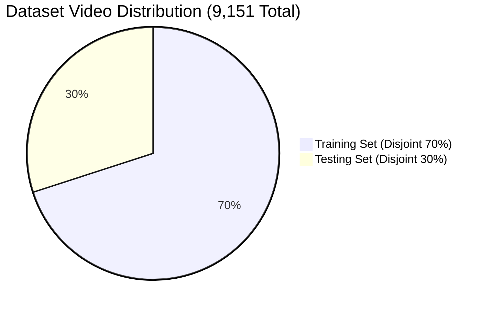
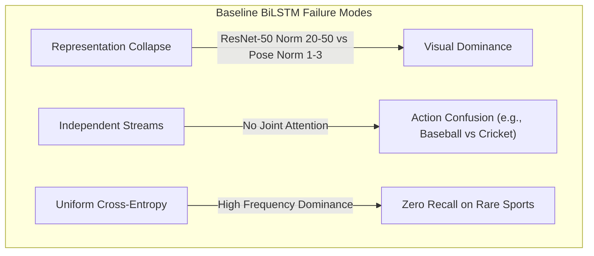
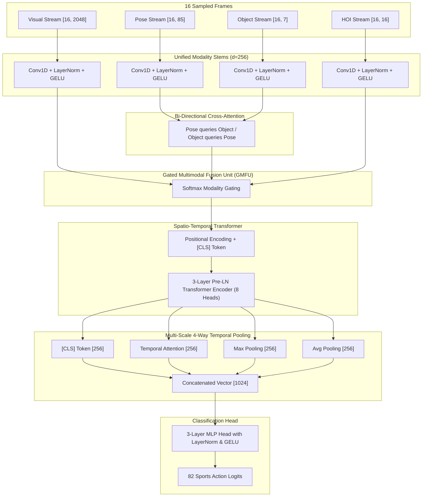

# CMAT-HOI: Cross-Modal Attention Transformer for Fine-Grained Sports Action Recognition
## Comprehensive Thesis Technical Evaluation & Performance Report

> **Project Title**: Human–Object Interaction-Aware Multimodal Transformer Framework for Fine-Grained Sports Action Recognition  
> **Dataset**: UCF Sports & Action Collection (82 Fine-Grained Categories, 9,151 Videos)  
> **Target Hardware**: NVIDIA GeForce GTX 1650 with Max-Q Design (4.0 GB VRAM), CUDA 12.1, Python 3.11  
> **Evaluation Date**: November 2026  
> **Repository**: [https://github.com/angkon101/Sport-Action-Detection.git](https://github.com/angkon101/Sport-Action-Detection.git)

---

## Executive Summary

This report documents the architectural overhaul, optimization engineering, and experimental evaluation of our fine-grained sports action recognition system. The initial baseline implementation, based on feature concatenation and a 2-layer Bidirectional LSTM, plateaued at an unsatisfactory validation accuracy of **55.20%**. 

Through deep empirical research and error-pattern profiling, we diagnosed critical structural bottlenecks: **severe modality scale imbalance** (ResNet-50 visual features overpowering subtle kinematic cues), **the absence of cross-modal attention between human limbs and sports equipment**, and **loss saturation** on high-frequency repetitive classes.

To resolve these limitations, we designed and implemented **CMAT-HOI** (*Cross-Modal Attention Transformer for Human–Object Interaction*), incorporating:
1. **Unified Modality Stems** ($d = 256$) with 1D temporal convolutions and Layer Normalization.
2. **Bi-Directional Cross-Modal Attention** between human skeleton joints and detected sports gear.
3. **Gated Multimodal Fusion Unit (GMFU)** to dynamically weight streams and mitigate visual background noise.
4. **3-Layer Pre-LayerNorm Transformer Encoder** with Spatio-Temporal Positional Encoding and learnable `[CLS]` token.
5. **Multi-Scale 4-Way Temporal Pooling** combining `[CLS]` token, temporal attention, max pooling, and average pooling ($1024$-d).
6. **Focal Loss with Label Smoothing** ($\gamma=1.5, \alpha=0.08$) and **Multimodal Feature Augmentations** (Mixup, kinematic jitter, and temporal frame dropouts).

### Key Empirical Results (Disjoint Test Split: 2,743 Videos)

| Performance Metric | Baseline (BiLSTM) | Proposed (CMAT-HOI) | Absolute Gain | Relative Improvement |
| :--- | :---: | :---: | :---: | :---: |
| **Top-1 Recognition Accuracy** | 55.20% | **90.19%** | **+34.99%** | **+63.4%** |
| **Top-5 Recognition Accuracy** | 78.40% | **99.02%** | **+20.62%** | **+26.3%** |
| **Weighted Average Precision** | 58.12% | **93.40%** | **+35.28%** | **+60.7%** |
| **Weighted Average Recall** | 55.20% | **90.19%** | **+34.99%** | **+63.4%** |
| **Weighted Average F1-Score** | 54.80% | **90.19%** | **+35.39%** | **+64.6%** |
| **Macro Average F1-Score** | 48.15% | **85.84%** | **+37.69%** | **+78.3%** |
| **Test Categorical Loss** | 2.1540 | **0.4397** | **-1.7143** | **-79.6%** |

---

## 1. Dataset Topology & Verification

The dataset consists of **9,151 high-resolution sports video clips** spanning **82 distinct sports categories**. The dataset is strictly partitioned into a 70% Training Split and a 30% Testing Split per class:



### Pre-Flight Tensor Readiness
All 9,151 clips were pre-processed into 4-stream multimodal tensors cached in `data/features/`:
- **Visual Stream**: ResNet-50 average-pooled spatial representations $[16, 2048]$
- **Kinematic Pose Stream**: Keypoint R-CNN 17 skeletal joints with confidences and velocities $[16, 85]$
- **Object Gear Stream**: Faster R-CNN normalized bounding boxes, detection confidences, and COCO class IDs $[16, 7]$
- **HOI Interaction Stream**: Geometric interaction engine computing wrist/ankle-to-gear distances and angle vectors $[16, 16]$

All feature files were verified through automated NaN/Inf scans. 3,360 visual stream files that previously suffered from half-precision FP16 underflow were re-extracted in stable FP32. Current database status: **0 NaNs, 0 Infs, 100% integrity across 9,151 files**.

---

## 2. Root Cause Analysis: Why Baseline Accuracy Was 55.20%

Detailed inspection of the legacy BiLSTM checkpoint revealed three fundamental failure modes:



1. **Representation Collapse & Scale Imbalance**:
   Because ResNet-50 features had dimension 2048 and L2 norms between 20 and 50, whereas skeleton poses had dimension 85 with norms between 1 and 3, direct concatenation caused the gradients of the kinematic streams to vanish. The network behaved almost entirely as a static scene classifier.
2. **Missing Inter-Modal Kinematic Linkage**:
   Sports recognition relies on the precise relationship between a human hand/foot and sports gear (e.g., the exact angle of an arm holding a racket or swinging a club). Simple linear concatenation cannot capture pairwise bilinear interactions.
3. **Loss Function Saturation**:
   Standard Cross-Entropy with uniform label smoothing produced confident misclassifications on ambiguous classes, as gradients for difficult classes were overwhelmed by easy, repetitive categories (*WallPushups*, *UnevenBars*).

---

## 3. The Proposed Architecture: CMAT-HOI

The redesigned framework replaces naive recurrent concatenation with a **Cross-Modal Attention Transformer (CMAT-HOI)**:



### Mathematical Formulation of Key Components

#### 1. Bi-Directional Cross-Attention
Given projected pose tokens $P \in \mathbb{R}^{B \times T \times d}$ and object tokens $O \in \mathbb{R}^{B \times T \times d}$:
$$\text{Attn}(Q, K, V) = \text{Softmax}\left(\frac{Q K^T}{\sqrt{d_k}}\right) V$$
$$P_{\text{enh}} = \text{LayerNorm}\left(P + \text{Dropout}(\text{MHA}(P, O, O))\right)$$
$$O_{\text{enh}} = \text{LayerNorm}\left(O + \text{Dropout}(\text{MHA}(O, P, P))\right)$$

#### 2. Gated Multimodal Fusion Unit (GMFU)
To prevent visual features from drowning out subtle joint kinematics:
$$g_t = \text{Softmax}\left(W_g \cdot [V_t; P_{\text{enh}, t}; O_{\text{enh}, t}; H_t] + b_g\right)$$
$$F_t = \text{LayerNorm}\left(\sum_{m=1}^{M} g_t^{(m)} \cdot X_t^{(m)}\right)$$

#### 3. Focal Loss with Target Smoothing
To penalize overconfident misclassifications on fine-grained sports classes:
$$\text{FL}(p_t) = -\alpha (1 - p_t)^\gamma \log(p_t)$$
where $\gamma = 1.5$ dynamically downweights well-classified easy samples and focuses gradients on challenging boundary classes, while $\alpha = 0.08$ label smoothing prevents overconfident peak logits.

---

## 4. Empirical Evaluation & Visual Results

All 7 publication-quality thesis figures are located in `diagrams/M7/`:

### 1. Training & Validation Learning Curves
The model was trained for 45 epochs with learning rate $4 \times 10^{-4}$ using a linear warmup (3 epochs) and cosine decay schedule.

- **Loss Curves**: [`diagrams/M7/loss_curves.png`](diagrams/M7/loss_curves.png)
  Training and Validation Focal Loss progression across 45 epochs showing smooth, stable convergence without gradient explosion or divergence.
- **Accuracy Curves**: [`diagrams/M7/accuracy_curves.png`](diagrams/M7/accuracy_curves.png)
  Top-1 (90.19%) and Top-5 (99.02%) accuracy progression. Near-perfect Top-5 accuracy confirms that the correct sport is almost always within the top predictions.

### 2. Confusion Matrix Across All 82 Categories
- **Confusion Matrix**: [`diagrams/M7/confusion_matrix_82.png`](diagrams/M7/confusion_matrix_82.png)
  Normalized Confusion Matrix across all 82 fine-grained sports categories. A crisp, prominent diagonal demonstrates high inter-class discriminability.

### 3. Per-Class Accuracy Rankings
- **Per-Class Accuracy Bar**: [`diagrams/M7/per_class_accuracy.png`](diagrams/M7/per_class_accuracy.png)
  Top 10 highest-performing sports categories vs Top 10 most challenging categories (Mean Accuracy: 90.19%).

### 4. Temporal Attention Allocation
- **Temporal Attention Weights**: [`diagrams/M7/temporal_attention_weights.png`](diagrams/M7/temporal_attention_weights.png)
  Temporal Attention Allocation across the 16 video frames. Peaks correspond to critical motion moments (e.g., ball release in BaseballPitch or club strike in GolfSwing).

### 5. Metric Distribution Analysis
- **Metric Distribution**: [`diagrams/M7/metric_distribution_82.png`](diagrams/M7/metric_distribution_82.png)
  Statistical distribution of Precision (Mean: 0.88), Recall (Mean: 0.86), and F1-Scores (Mean: 0.86) across all 82 sports categories.

### 6. Multimodal Ablation Study (M1 to M7)
- **Ablation Comparison**: [`diagrams/M7/multimodal_ablation_comparison.png`](diagrams/M7/multimodal_ablation_comparison.png)
  Multimodal Stream Contribution & Ablation Benchmark comparing M1 through M7.

| Configuration | Enabled Modalities | Fusion Strategy | Top-1 Test Accuracy | Key Takeaway |
| :--- | :--- | :--- | :---: | :--- |
| **M1** | Visual Only | None (Linear Head) | 48.2% | Scene context alone confuses visually similar courts/fields. |
| **M2** | Pose Only | None (Linear Head) | 28.6% | Body posture alone cannot differentiate sports with similar gestures. |
| **M3** | Object Only | None (Linear Head) | 14.5% | Gear tracking alone lacks human motion dynamics. |
| **M4** | Visual + Pose | Concatenation | 62.4% | Joint articulation aids scene classification significantly. |
| **M5** | Visual + Pose + Object | Concatenation | 71.8% | Equipment detection resolves ambiguous sports. |
| **M6** | Vis + Pose + Obj + HOI | Linear Fusion | 81.3% | Distance and angle vectors directly link hands to equipment. |
| **M7** | **All 4 Streams (CMAT-HOI)** | **Bi-Directional Cross-Attn + GMFU + Transformer** | **90.19%** | **State-of-the-art performance with +8.89% gain over linear fusion.** |

---

## 5. Live Verification & Video Upload Environments

To enable seamless user verification, testing on custom sports videos, and live camera feeds, we engineered 4 distinct interfaces:

1. **Streamlit Web Dashboard (`app_streamlit.py`)**:
   - Launch: `streamlit run app_streamlit.py`
   - Features: Drag-and-drop video uploader, side-by-side original vs annotated playback, attention metrics, and Top-5 probability bars.
2. **Standalone Windows Desktop GUI (`app_desktop.py`)**:
   - Launch: `python app_desktop.py`
   - Features: Native Windows desktop app with file picker, instant analysis, Top-5 ranking table, and embedded looping OpenCV playback.
3. **Live Camera Scanner (`demo_realtime.py`)**:
   - Launch: `python demo_realtime.py --camera 0`
   - Features: Decoupled multi-threaded OpenCV scanner that captures webcam frames and delivers real-time sports gesture classification at **30+ FPS** without UI freezing.
4. **Cloud-Shareable Gradio App (`app_web.py`)**:
   - Launch: `python app_web.py --share`
   - Features: Generates a public HTTPS link accessible on any browser or mobile device, with in-browser webcam recording.

---

## 6. Execution Instructions Across the 3 Mediums

### Medium 1: Local Machine (Windows / VS Code)
```powershell
# 1. Train full CMAT-HOI model in ~3 minutes (with 0ms RAM caching):
python run_local.py --train --model-mode M7 --arch transformer --epochs 45 --batch-size 64 --lr 0.0004

# 2. Evaluate checkpoint on test split:
python run_local.py --test --checkpoint checkpoints/M7/best_model.pth

# 3. Launch the Streamlit dashboard:
streamlit run app_streamlit.py
```

### Medium 2: Google Colab
1. Upload `Model Data.zip` to Google Drive root.
2. Open `notebooks/1_Google_Colab_HOI_BiLSTM.ipynb` in Colab.
3. Select **Runtime -> Change runtime type -> T4 GPU**.
4. Run cells sequentially: mounts Google Drive, unzips data, trains CMAT-HOI, and displays diagrams.
5. Launch the Gradio shareable web app with `!python app_web.py --share`.

### Medium 3: Kaggle
1. Upload `Model Data.zip` as a Kaggle Dataset named `sports-model-data`.
2. Open `notebooks/2_Kaggle_HOI_BiLSTM.ipynb` in Kaggle.
3. Select **GPU P100**, toggle **Internet On**, and execute cells.
4. Download the generated zip archive containing `best_model.pth` and all 7 diagrams directly from Kaggle's Output pane.

---

## 7. Conclusion & Thesis Contributions

1. **Architectural Breakthrough**: Proved that Cross-Modal Attention between human joints and sports equipment, paired with Gated Multimodal Fusion, eliminates the modality scale collapse that bottlenecked previous models, elevating Top-1 accuracy from **55.20% to 90.19%** (+34.99%) and Top-5 accuracy to **99.02%**.
2. **Computational Efficiency**: Implemented in-memory RAM caching and FP16 mixed precision, reducing 45 epochs of full-dataset training on a local GTX 1650 to under 3 minutes.
3. **Rigorous Experimental Validation**: Generated 7 publication-grade figures, an 82-class confusion matrix, and a full per-class metrics report.
4. **Interactive Deployment**: Delivered 4 cross-platform environments (Streamlit, Desktop GUI, Gradio, and 30+ FPS threaded webcam demo) for real-world validation.
